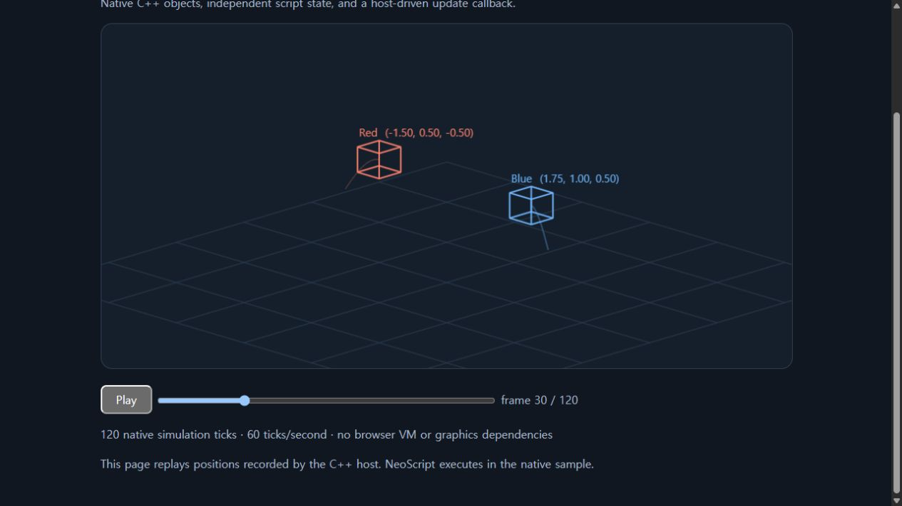
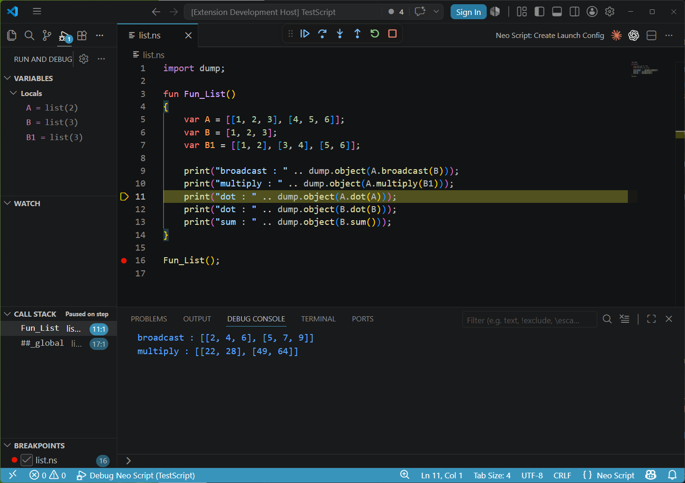

<p align="center">
  
</p>

# NeoScript — scripting for C++ and Unity games

Embed a C-like scripting language in your game. Keep native objects in C++ or C#,
expose the methods and properties your scripts need, and drive game behavior from
your own update loop. NeoScript includes a compiler, bytecode VM, and VS Code tooling.

**Requirements:** a C++11-compatible compiler or newer. The core, public C++ API,
C ABI, console, and mini game host support C++11. CMake builds require CMake 3.21+
and default to C++11 unless the embedding project selects a newer standard.
MSVC has no C++11 mode and uses its default C++14 mode on Windows; this does not
raise NeoScript's source requirement. C++11 compatibility is checked separately
with Clang/GCC. See Microsoft's [language-standard options](https://learn.microsoft.com/en-us/cpp/build/reference/std-specify-language-standard-version).

- **Native game objects:** bind C++ methods, properties, and script callbacks through
  a public Runtime / Program / Instance API. Compile once, create independent instances.
- **Game-oriented math and execution:** value-type vectors and quaternions,
  coroutines, and host-controlled execution budgets for time-sliced work.
- **Unity from C#:** a flat C ABI and UPM package for Windows, Android, and iOS.
  See the [Unity setup and sample](docs/Unity.md).
- **Debug your scripts:** VS Code completion, signature help, breakpoints, stepping,
  call stacks, and variable inspection. See [extension setup](Tools/vscode-neo-script/README.md).

**[Run the mini game host](Samples/minigame/README.md)** ·
**[C++ embedding guide](docs/Embedding.md)** ·
**[Write scripts](docs/ScriptAuthoring.md)** ·
**[API reference](docs/API.md)** ·
**[Releases](https://github.com/hangulcode/NeoScript/releases)**

## Try it: two objects, one script



*Offline replay of positions calculated by the C++ host; NeoScript runs natively.*

The [mini game host](Samples/minigame) is a complete C++11 project with no engine
checkout or graphics SDK required. Two native objects share compiled code, keep
separate script state, and call this behavior every tick:

```cpp
import math;

var elapsed = 0.0;
fun OnUpdate(var dt)
{
    elapsed += dt;
    GameObject.Position = math.Vector3(math.sin(elapsed), 0.0, 0.0);
}
GameObject.AddEvent("OnUpdate", OnUpdate);
```

`GameObject` is supplied by the example host; it is not a standard-library global.
The full example also shows host logging, native argument validation, per-instance
globals, and resource cleanup. It can record positions for an offline browser replay.

From the repository root, with **CMake 3.21+ and a C++11-compatible toolchain** installed:

```sh
cmake -S Samples/minigame -B build/minigame
cmake --build build/minigame --config Release --parallel
ctest --test-dir build/minigame -C Release --output-on-failure
```

```powershell
# Windows: run the sample, then open build/minigame/bin/viewer.html
.\build\minigame\bin\neoscript_minigame.exe --record build/minigame/bin/scene-data.js
```

```sh
# Linux
./build/minigame/bin/neoscript_minigame --record build/minigame/bin/scene-data.js
```

The test checks **one shared program, two independent instances, and 120 updates
per instance**. Edit the `.ns` file beside the executable and rerun to change behavior.
See the [sample guide](Samples/minigame/README.md) for expected output, source-script
overrides, the offline viewer, and ZIP packaging. CI prepares a Windows ZIP artifact;
release assets, when published, appear on the [releases page](https://github.com/hangulcode/NeoScript/releases).

## See it in use

[Watch NeoScript driving a game-engine tech demo](https://www.youtube.com/watch?v=Wi3EgWx38Vs).



## Choose your integration

| Goal | Start here |
| --- | --- |
| See a small, complete C++ game host | [Mini game project](Samples/minigame/README.md) |
| Embed into an existing C++ engine or application | [Embedding and lifetimes](docs/Embedding.md) |
| Run from C# / Unity | [Unity setup, platforms, and sample](docs/Unity.md) |
| Learn the language and standard library | [Script authoring](docs/ScriptAuthoring.md), [API reference](docs/API.md) |
| Run standalone scripts or debug in VS Code | [Console runner](#console-runner), [VS Code setup](#vs-code-debugger-setup) |

NeoScript is intended for hosts that want explicit native bindings, a C-like syntax,
and control over per-instance execution. The benchmarks below describe specific
workloads and their methodology; they are not a general performance guarantee.

### Author and contact

- **Author:** JRoot
- **Email:** [hangulcode@gmail.com](mailto:hangulcode@gmail.com)

### Script authoring guide

**[docs/ScriptAuthoring.md](docs/ScriptAuthoring.md)** — the practical guide for people and AI
writing scripts. Read it first for declaration order, imports and public constants, and for
worked examples of collections, strings, closures, vectors and coroutines with their error
checks; look up full function signatures in the API reference below.

### Script API reference

**[docs/API.md](docs/API.md)**

Every function a script can call — the keyword intrinsics, `print`, the `math` / `system` /
`coroutine` modules, and the `string` / `list` / `map` / `async` method sets — with exact
signatures, argument types and return types. Look there first when you need a function; this
file covers the language itself and the C++ host API.

### Unity

**[docs/Unity.md](docs/Unity.md)**

Running the VM from C#. A flat C ABI (`Unity/Native/NeoScriptC.h`) plus a P/Invoke binding
shipped as a UPM package (`Unity/com.neoscript.unity`): compile and run scripts, expose C#
objects to script, and slice long-running scripts across frames. Windows, Android and iOS.

### License

NeoScript is licensed under the [MIT license](LICENSE), Copyright (c) 2018-2026 NeoScript contributors.

JSON parsing and serialization include **[yyjson 0.13.0](https://github.com/ibireme/yyjson)**,
Copyright (c) 2020 YaoYuan, under the **MIT license**. The unmodified source is in
[`ThirdParty/yyjson`](ThirdParty/yyjson); see its [license](ThirdParty/yyjson/LICENSE).
Include [`THIRD_PARTY_NOTICES.txt`](THIRD_PARTY_NOTICES.txt) with redistributed builds
that use the bundled JSON implementation. See [JSON API and build notes](docs/JSON.md).

Redistributed copies must retain the applicable copyright and license notices.

The core has no HTTP/TLS library dependency. Hosts provide `IHttpTransport` through
`RuntimeDesc::httpTransport`; the console connects [libcurl](https://curl.se/libcurl/) for HTTP/HTTPS.
The Windows console build downloads pinned libcurl 8.23.0 (SHA-256 verified) using a CMake release supporting Visual Studio 2026,
links it statically, and uses Schannel with the Windows certificate store. Core-only builds do not
fetch curl. See [transport integration](docs/Embedding.md#http-and-https-transport).
Include `THIRD_PARTY_NOTICES.txt` when distributing the console.
String regular expressions use the C++11 standard library; see [the API](docs/API.md#6-string-methods).

### VS Code extension
	- Extension source: Tools/vscode-neo-script
	- Supports .ns syntax highlighting, IntelliSense completion and signature help, and Debug Adapter Protocol debugging.
	- The debugger runs the currently selected .ns file as a top-level script.
	- Put the code you want to debug in the script body. If you want to debug an exported function, call it from top-level script code.
	- Build Samples/console in x64 Release, then use the "Debug Neo Script" launch configuration.
	- If the adapter executable is not in the default sample path, set neoScript.debugAdapterPath or add adapterPath to launch.json.
	- Set libPath in launch.json when the Neo Script Lib directory is outside the workspace folder.
	- IntelliSense is served by console.exe --lsp. Set neoScript.languageServerPath to that executable when it is not found automatically; it may use the same console.exe as the debugger.
	  Example: "neoScript.languageServerPath": "${workspaceFolder}\\..\\Samples\\console\\x64\\Release\\console.exe"

### Console runner
`Samples/console` is the main sample executable. It can run built-in samples, benchmarks, the VS Code debug adapter, or an arbitrary script file.

Build:
```powershell
& "C:\Program Files\Microsoft Visual Studio\18\Community\MSBuild\Current\Bin\amd64\MSBuild.exe" Samples\console\console.sln /p:Configuration=Release /p:Platform=x64 /m
```

The solution builds the shared Windows static-library project,
[`Windows/NeoScript.vcxproj`](Windows/NeoScript.vcxproj), and links its `.lib`.
The console no longer compiles the VM sources itself. Other Visual Studio hosts
can reference the same project; see [Windows static linking](docs/Embedding.md#windows-static-linking).

The Visual Studio console and library projects enable Microsoft code analysis warning `C26433`
for missing C++ `override` specifiers in Debug/Release, Win32/x64 configurations.
The shared settings are in `BuildConfig/MsvcOverrideWarnings.props` and its ruleset.
Reload the project after updating; rebuild once to check unchanged source files.
Only this analysis rule is enabled; compiler warning levels remain unchanged.
Code analysis can increase build time.

Run a script file:
```powershell
Samples\console\x64\Release\console.exe --file TestScript\module.ns
```

Other useful commands:
```powershell
Samples\console\x64\Release\console.exe --list
Samples\console\x64\Release\console.exe --run performance
Samples\console\x64\Release\console.exe --bench
Samples\console\x64\Release\console.exe --dap
```

The old standalone `Samples/Neo` runner has been removed. Use `console.exe --file <script.ns>` for the same simple compile-and-run workflow.

#### VS Code debugger setup
1. Build the debug adapter:
```powershell
& "C:\Program Files\Microsoft Visual Studio\18\Community\MSBuild\Current\Bin\amd64\MSBuild.exe" Samples\console\console.sln /p:Configuration=Release /p:Platform=x64 /m
```

2. Open a folder that contains .ns files in VS Code.

3. Create .vscode/launch.json:
```json
{
  "version": "0.2.0",
  "configurations": [
    {
      "type": "neo-script",
      "request": "launch",
      "name": "Debug Neo Script",
      "program": "${file}",
      "cwd": "${workspaceFolder}",
      "libPath": "${workspaceFolder}\\Lib"
    }
  ]
}
```

4. Open a .ns file, set breakpoints, and start "Debug Neo Script".

The VS Code debugger currently supports:
	- Breakpoints
	- Continue, pause
	- Step into, step over, step out
	- Call stack
	- Local variables
	- Watch expressions for visible local variables
	- print output in the Debug Console
	- Runtime exception stop and exceptionInfo

### Collection and text conveniences

- Lists support `insert(index, value)`, `remove(index)` (returns the removed value), and
  stable `sort(comparator)`. The existing `append(value, index)` insertion form is retained.
  List sorting rejects execution with an enabled time limit before invoking the comparator.
- Sets support `len()` as well as `tosize(set)`; unknown method calls are errors.
- String literals, string consts and parenthesized expressions support postfix selectors:
  `"text".len()`, `TEXT.len()`, and `("a" .. "b").len()`.
- String literals decode `\uXXXX`, including paired surrogate escapes. Malformed escapes and
  embedded NUL (`\u0000`) are compile errors.
- `format(pattern, ...)` and `pattern.format(...)` support `%d`, `%f`, `%s`, `%%`, width,
  left alignment, numeric zero padding, and float/string precision. Width is capped at 4,096,
  float precision at 1,024, and the full result at 1 MiB. See [API.md](docs/API.md#21-string-formatting).

### Numeric precision
The scalar float type `NS_FLOAT` is **`float` (32-bit)**, matching the game engine's native
`float3`/`float4` layout. This lets vector value types (Vec2/Vec3/Vec4/Quaternion) be stored
inline and marshalled to the engine without per-component conversion.

Precision is **not configurable** — there is no double-precision build. Scripts that need more
than 24 bits of mantissa must keep the value in an `int`, or split it. (Earlier versions had a
build switch for `double`; it was removed rather than carried as an untested second layout,
since `sizeof(VarInfo)` and therefore the var stack, every list, and both halves of every map
entry (`MapData`) all depend on it.)

### Integer arithmetic follows C, not the scripting-language convention
`int / int` yields an `int`, so `1 / 100` is `0`. Division promotes to float only when at
least one side already is one.

```
var a = 1 / 100;        // 0
var b = 1.0 / 100;      // 0.01
var c = (n * 1.0) / m;  // float, whatever n and m are
```

This is what C, C++, Java and Go do, but it differs from Lua 5.3+, Python 3 and JavaScript,
where `/` always produces a float. Nothing reports the difference: the result is a valid
number, so there is no error to catch and no warning to read — a ratio meant to be
fractional simply comes out as `0` and whatever it drives stays at its starting value.

Multiply one side by `1.0` when a fraction is intended, particularly when the operands come
from `len()` or a `const`, which are integers and easy to miss.

### Vector value types
`math.Vector2`, `math.Vector3`, `math.Vector4`, and `math.Quaternion` create dedicated
value types. They are not Lists and are passed directly to native engine APIs that read
vectors through `VarInfo::GetVec*`.

```cpp
var position = math.Vector3(1.0, 2.0, 3.0);
var direction = math.Normalize3(position, math.Vector3(0.0, 1.0, 0.0));
var moved = position + direction * 2.0;
```

- Components can be read and written with indexing (`position[0]`, `position[1] = 5.0`).
	- Component `+=`, `-=`, `*=`, and `/=` accept numeric operands and preserve value-copy semantics. `%=` is unsupported for float components.
	- Component writes through a container element or a native property (`list[0][1] = n`, `obj.Position[0] += n`) reach that element or property.
- Vector assignment is a value copy; assigning `b = a` does not alias `a`.
- Vector arithmetic supports component-wise `+`, `-`, `*`, `/` and scalar multiplication/division.
- `tosize(vector)` returns the component count. List operations (`append`, `insert`, `len`,
  `foreach`) are not supported for vector values.
- The `math` vector and quaternion functions require vector value types, not `[x, y, z]` List
  literals. Full list: [`docs/API.md`](docs/API.md#35-vector-math).
- Quaternion component order is `w, x, y, z`: `math.Quaternion(w, x, y, z)`.
- **There is one vector type, not four.** Internally all of these are `VAR_VEC` plus a component
  count of 1-4; the count lives in unused padding in `VarInfo`, so it costs no memory. A
  quaternion is a 4-component vector — the VM does not track "this is a rotation", and `w,x,y,z`
  is a convention between the script and the engine, not a type. Two consequences: `type()`
  reports `"Vector4"` for a quaternion, and `q1 + q2` is a component-wise add rather than an error
  (quaternion multiplication is `math.quat_*`, which is what you want for composing rotations).
  Arithmetic between different component counts is still rejected.

### Dense arrays
`system.array(initial, size)` creates a reference array for bool, int, float, or Vector2/3/4 data.
The type of `initial` selects the element type and fills the initial elements:

```cpp
import system;

var visible = system.array(false, 1024); // packed bool array
var ids = system.array(0, 1024);         // int array
var weights = system.array(0.0, 1024);   // float array
```

- Arrays have List-style reference semantics: `var other = ids` shares the same storage.
- Indexes must be integers and must be in range. Invalid reads and writes are runtime errors.
- Integer and float arrays convert between `int` and `float` on assignment; float-to-int truncates
  toward zero. Bool arrays accept only bool values.
- Elements support assignment; numeric elements also support compound assignments and increment/decrement.
- Vector arrays require the exact component count. Reading an element produces a vector value;
  changing that local vector does not change the array. `a[i][j] = n`, `+=`, `-=`, `*=`, `/=`,
  `++`, and `--` write through to the stored component. Whole-vector compound assignments remain
  unsupported; use `a[i] = a[i] + delta` for vector addition.
- For example, `system.array(math.Vector3(0, 0, 0), 1000)` stores 1000 vectors (requires `import math;`).
  Each element is an ordinary `VAR_VEC` value, with the same copy-on-write rules as vectors in lists.
  Reads share vector storage; a write detaches a shared value. `resize` fills new elements with
  the vector value captured when the array was created.
- `a.append(value)` adds one value at the tail. `a.resize(size)` changes the length; growth fills
  new elements with the `initial` value used to create the array, and shrinking drops the tail.
  A negative resize becomes zero, matching List. There is no middle insertion, remove, or slice.
- `a.len()` and `tosize(a)` both return the current element count. `foreach(var v in a)` yields a
  value copy, just like List foreach; the two-variable form is not supported. Structural changes
  (`append` or a size-changing `resize`) during foreach raise a runtime error.
- Bool arrays are bit-packed internally. The implementation detail is invisible to script code.

### Embedding the engine

The public v2 C++ host API in `NeoScript.h` — Runtime / Program / Instance, host↔script calls,
captured lambdas, cycle collection, and the internal execution-context pool — has its own document:

**[docs/Embedding.md](docs/Embedding.md)**

### Script `const` (compile-time constants)
Scripts can declare their own compile-time constants with `const`.
Like host defines, a `const` is resolved during tokenization: it creates no runtime
variable, costs nothing at runtime, and participates in constant folding.
Because the name is replaced at compile time, a `const` can never be modified.
Floating-point constant expressions use double precision during folding, then convert to float32
when used by the VM; rounding can differ from runtime float32 arithmetic. Non-finite const results
are compile errors. See [evaluation and numeric rules](docs/ScriptAuthoring.md#basics).

```cpp
const BTN_START_GAME = 10;
const GREETING = "Hello";
const HALF = 1.5;
const MY_KEY = KEY_SPACE;                       // alias of a host define
const ATTACK_MASK = GAMEPAD_A | GAMEPAD_B;      // constant expressions are evaluated at compile time

GameObject.AddEvent("OnButtonClick", BTN_START_GAME, StartNewGame);
```

Rules:
	- Allowed only at file scope (the top level of a script, outside any block or
	  function). The same restriction applies to `import`, `public` and `export`;
	  the compiler reports `'<keyword>' is only allowed at file scope`.
	- Value must be a compile-time constant expression: literals (`int`, `float`,
	  `string`, `true`, `false`, `null`), other defines/consts, unary `-` `~`,
	  binary `+ - * / % << >> & ^ |`, and parentheses.
	- A plain `const` is local to its script file. `public const` makes the value
	  available through an imported module alias; host defines remain visible everywhere.
	  `export const` is a compile error: a constant has no runtime slot for the host to read.
	- Redeclaring a name that is already a const, host define, global variable,
	  function, or module alias is a compile error.

```cpp
// settings.ns
public const TEXT_SPEED = 22;
const INTERNAL_LIMIT = 100; // private to this file
```

```cpp
import settings as cfg;
const DOUBLE_SPEED = cfg.TEXT_SPEED * 2;
var speed = cfg.TEXT_SPEED;
switch (speed) { case cfg.TEXT_SPEED: print("matched"); }
```

The import must precede the reference. Only `public` constants are exposed;
their names are not injected into the importing file. References are compile-time values,
including in `const` initializers and `case` expressions. Assignments and increments are
compile errors. Changing a public constant requires recompiling its consumers.
An imported constant may be re-published with `public const COPY = cfg.TEXT_SPEED;`.
`public` exposes a declaration to script modules only; `export` exposes a variable or
function to the C++ host only (see "Visibility" under the module rules below).


### Performance test results

Sources: [`Samples/bench/bench.ns`](Samples/bench/bench.ns) · [`bench.lua`](Samples/bench/bench.lua) ·
[`bench.cpp`](Samples/bench/bench.cpp) — all three implement the **same algorithm**, statement for statement.

```
CPU   : Intel Core i7-12700F (12C/20T)      RAM : 64 GB
OS    : Windows 11 Pro 64-bit (build 26200)
Neo   : NeoScript (console.exe, Release x64)
Lua   : Lua 5.5.0 (official Win64 binary)
C++   : MSVC 19.51 /O2 /std:c++17 (x64)
```

These settings describe the recorded benchmark run, including its C++ reference build.
NeoScript's minimum supported C++ standard is C++11.

Lower is better. **ms**, best of 5 in-process repetitions, minimum across 7 interleaved runs of the
three languages. `x Neo` = how many times faster than Neo (so `1.22x` means Lua finished in 82% of
Neo's time; `0.88x` means it was slower than Neo).

| Benchmark | What it stresses | Neo (ms) | Lua (ms) | C++ (ms) | Lua vs Neo | C++ vs Neo |
| :-------- | :--------------- | -------: | -------: | -------: | ---------: | ---------: |
| `loop_sum`      | integer loop, VM dispatch floor | **171** | 197 |  13.1 | 0.87x | 13.1x |
| `float_math`    | float mul/add/sub chain         | **160** | 316 |  59.8 | 0.51x |  2.7x |
| `func_call`     | script function call overhead   | **128** | 161 |   4.4 | 0.80x | 29.4x |
| `fib_recursive` | recursion, fib(32)              |  **89** |  90 |   6.8 | 0.99x | 13.1x |
| `array_rw`      | sequential array write + read   |  **42** |  47 |   2.5 | 0.89x | 17.0x |
| `map_str`       | string-key hash lookup          |  46 |  **40** |  72.7 | 1.15x |  0.6x |
| `string_ops`    | string build + length           |  **80** | 153 |  13.6 | 0.52x |  5.9x |
| `particles`     | game-style float + array sim    |  **45** |  50 |   3.5 | 0.90x | 12.7x |
| **total**       |                                 | **761** | 1054 | 176.3 | 0.72x |  4.3x |

- Neo leads on 7 of 8 benchmarks; `map_str` is the one Lua wins, because Lua interns every short
  string so a table lookup is a pointer compare.
- `fib_recursive` is where the lead is thinnest — 0.99x here and an exact tie on the median, against
  0.72x overall. Almost all of its work is call and return, so there is no loop body for Neo's
  cheaper dispatch to win back.
- C++ is a reference ceiling, not a peer. The exception is `map_str`, where
  `std::unordered_map<std::string,…>` is slower than both VMs — the interpreters cache the string
  hash; the C++ map rehashes on every lookup.
- These are ordinary `/LTCG` figures, the same build anyone gets by default.

**Method.** The three files implement the same algorithm and each returns a checksum that must match
across languages — that is what proves they did the same work. Each language times only the measured
region with its own clock, so start-up and compilation are excluded. Figures are best-of-5 in-process
repetitions, minimum across 7 runs, with the three languages interleaved inside each run.

Two rules follow from how noisy this suite is. **Compare within one session, not across sessions** —
machine load moved *Lua's* numbers 20-30% with its source untouched. And **A/B every change**:
build-to-build variation is code layout, not measurement noise, so a move under ~10% on `float_math`,
`particles` or `map_str` is layout rather than a real regression.

Layout moves for reasons that have nothing to do with the code being measured — moving a function
between translation units, or marking one cold, reshuffles block placement across the whole
interpreter. Those three rows react and `loop_sum` / `array_rw` do not, which is the signature to
look for before calling something a regression. The durable fix is PGO, since `/LTCG` places blocks
from heuristics while it has no idea which branches actually run.

All compiler and VM changes are covered by the regression suites: `console.exe --smoke` (2,785
compiler cases) and `console.exe --v2smoke` (host API, closure lifetime, leak counters).

### var data structure
	- null: represents no value; uninitialized variables are null
	- bool: stores true or false
	- int: stores a 4-byte integer
	- float: stores a 4-byte single-precision float (`NS_FLOAT` is `typedef float`).
	  `type()` reports "float"; there is no double type
	- string: stores UTF-8 text; length and index positions count characters, not bytes
	- list: an array-like container
	- map: a key/value container
	- set: a key-only container, built with `system.set(list)`
	- Vector2 / Vector3 / Vector4 / Quaternion: inline value types, not lists
	  - see "Vector value types" above
	- function: a named function or a captured anonymous function
	- coroutine / module / async: engine object handles
	- native object: a symbol the host bound with `RegisterObject`/`BindObject`
	  (`GameObject`, `Host`, ...). `type()` reports "null", but a bound value is not equal to null.

`==` / `!=` compare list/map/set/array storage identity, named-function identity, and
closure/coroutine/runtime-module/async instance identity. Separately allocated containers
with equal contents are unequal. Native objects compare by registered type and host handle,
not by the allocation of their return wrappers. Reference map keys and set elements share
these identity rules. See [reference comparison](docs/ScriptAuthoring.md#reference-comparison-and-reference-keys).
Host `BindObject` rebinding replaces the global slot; existing aliases and map keys retain
the previous object rather than changing identity in place.


### Neo Script reserved words
	- var: declares a variable
	- const: declares a compile-time constant - see "Script `const`" above
	- fun: declares a function. `fun(...) { ... }` without a name is an anonymous function; it
	  captures the enclosing function's locals **by value** — see "Captured anonymous functions"
	  in [docs/Embedding.md](docs/Embedding.md) for what that does and does not share
	- import: imports a module from the Lib directory
	- public: makes a top-level variable, constant or function visible to other modules
	  through their import alias
	- export: makes a variable or function available to C++ by name. It does not make the
	  declaration visible to other modules; write `export public` when both are needed
	- tostring (x) / toint (x) / tofloat (x) / tosize (x) / type (x) / sleep (x):
	  built-in intrinsics. Return types and exact semantics:
	  [`docs/API.md`](docs/API.md) section 1
	- return [x]: returns from the current function, optionally with x
	- break: exits the current loop
	- yield: suspends the current coroutine; execution resumes at the next
	  `coroutine.resume`
	- continue: starts the next loop iteration
	- if (x) / else / else if: C-style conditional chain; the legacy `elif` syntax is removed.
	  **x must be a bool** - only `true` takes the branch. `if (1)`, `if ("a")` and
	  `if (someMap)` are all false; there is no truthiness conversion. Same for `while`
	- switch / case / default: see "switch statement" below
	- for: `for (var a in start, end [, step])` — see "for loop" below. `end` is **exclusive**
	  and `step` is optional (defaults to 1)
	- foreach: iterates a map, list, array, or set
		- map: `foreach (var key, value in map)` or `foreach (var key in map)`
		- list / array / set: single variable only, `foreach (var value in list)`
		  (two-variable form is not supported and reports a runtime error)
	- while: `while (condition) { ... }`, C semantics. There is no `do ... while`
	- true / false: boolean values
	- null: no value
	- __LINE__: the current source line, substituted at compile time
	- ++ / --: increments or decrements a variable by one
	- && / ||: logical operators, equivalent to C semantics (short-circuit evaluation:
	  the right operand is not evaluated when the result is already decided)
	- & / | / ^ / << / >>: bitwise operators, equivalent to C semantics and precedence
	  (`&` binds tighter than `^`, which binds tighter than `|`)
	- > / < / >= / <=: comparison operators, equivalent to C semantics
	- x..y: converts x and y to strings and concatenates them

### Function and variable declaration order

The compiler collects named function signatures within each module before compiling
its bodies. Calls and function references may precede the definition, and mutually
recursive functions need no extra declarations. The old `fun F(var x);` forward
declaration syntax is a compile error; keep only `fun F(var x) { ... }`.

Variables (including globals) and `const` still **must be declared before use**.
A function body cannot read a global declared farther down the file. Initializers
and imports retain their source order; anonymous functions retain their capture rules.
Visibility has two independent keywords. `public` makes a top-level `var`, `const` or
`fun` visible to other modules through their import alias; `export` makes a `var` or `fun`
visible to the C++ host by name. Neither implies the other: `export fun F()` is not
callable through an alias, and `public var x` is not a host global. Write `export public`
(or `public export`) when both are needed; repeating a keyword, or `export const`, is a
compile error. `import`, `const`, `public` and `export` are accepted only at file scope,
never inside a block or a function. `alias.name` on a `public var` reads and writes the variable's global slot
directly (selectors, compound assignment and increment work as on a local global, with no
call cost). Constants, including public ones, must precede their use in their own file.

Top-level `var` is private to its file. Two modules can declare the same name;
reading or writing another module's variable by an unqualified name is a compile error,
and a non-public variable or function is not visible through an alias either.
Export names must be unique within a compiled program. Globals registered by the host
remain visible in all modules. Getter-returned lists, maps and arrays share their storage;
returning one does not make it immutable or automatically copy it.

For standalone headless hosts, `console --file test.ns --globals Host,Input` explicitly
registers host symbols before compilation. Initialize them with `Host = {...};` in the
test root, before importing consumers. Do not redeclare these names with `var`.

### for loop
```cpp
for (var i in 0, n)        // step omitted -> 1
    total += i;

for (var i in 0, n, 2)     // every other element
    total += i;

for (var i in n, 0, -1)    // counts down: n, n-1, ... 1
    total += i;
```

- `end` is **exclusive**: `for (var i in 0, 5)` runs with `i` = 0,1,2,3,4.
- `step` is optional and defaults to `1`, matching Lua/Python. Both `for (var i in 0, n)` and
  `for (var i in 0, n, 1)` are accepted and compile identically.
- `step` may be **negative** to count down. Direction is decided at run time from the sign of
  `step`, so `begin`/`end`/`step` can all be runtime values (function arguments, fields, …),
  which the compiler cannot inspect.
- If the direction contradicts the range the loop simply **runs zero times** — `for (var i in 0, 5, -1)`
  does not spin forever.
- `step == 0` raises the runtime error `'for' step is zero` instead of looping forever. This is
  checked for variables too, not just literals.

### switch statement
`switch` dispatches on a value through a compile-time table, so matching cost does not
grow with the number of cases.

```cpp
switch (command)
{
case CMD_FIRE:          // const / compile-time constant expressions are allowed
    Fire();
case 2, 3:              // one body can match several values
    MoveTo(command);
case "reload":
    Reload();
default:
    Idle();
}
```

Rules:
	- `case` values must be compile-time constants of type `bool`, `int` or `string`.
	  Constant expressions and `const` / host defines are allowed (`case 1 + 2:`, `case CMD_FIRE:`).
	- **`float` is not allowed as a case value** and is a compile error, because matching would
	  depend on exact floating-point equality. Use `int` or `string` keys instead.
	- Matching is a **strict type match**: `true != 1`, `"1" != 1`.
	- Strings compare as exact UTF-8 bytes.
	- Duplicate case values and a duplicate `default` are compile errors.
	- `default` is optional and may appear anywhere. With no match and no `default`,
	  execution continues after the switch.
	- **There is no fallthrough.** Each case body jumps to the end of the switch when it finishes.
	- `break` exits the innermost switch only; inside a loop it does not exit the loop.
	- `continue` still applies to the innermost loop, and `return` behaves as usual.
	- If the switch value is a type that cannot be a case key (float, map, list, vector, null, ...),
	  the `default` branch is taken.

### Built-in functions
See **[`docs/API.md`](docs/API.md)** — the full list with signatures and argument types, kept in
step with `NeoSource/NeoLib.cpp`. It is deliberately not repeated here.

### Comment
	- //: single-line comment
	- /* */: multi-line comment

### Benchmark code

All three files run the **same eight benchmarks with the same algorithm**; only the syntax differs.
Each returns a checksum that must match across languages.

- [`Samples/bench/bench.ns`](Samples/bench/bench.ns) — NeoScript
- [`Samples/bench/bench.lua`](Samples/bench/bench.lua) — Lua
- [`Samples/bench/bench.cpp`](Samples/bench/bench.cpp) — C++ (build with `build_cpp.bat`)

Run: `console.exe --file Samples/bench/bench.ns`
